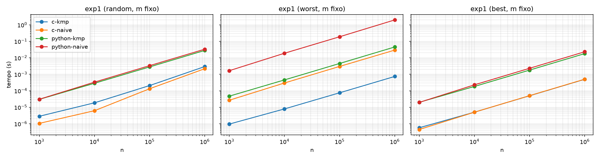
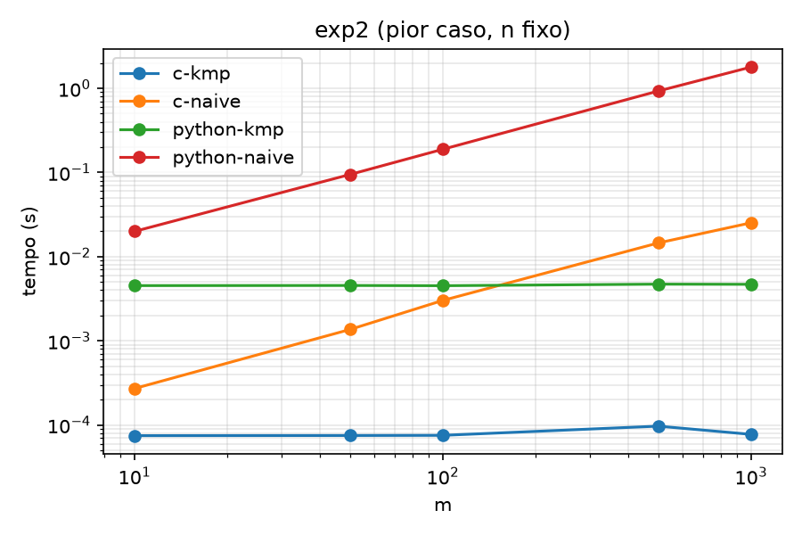
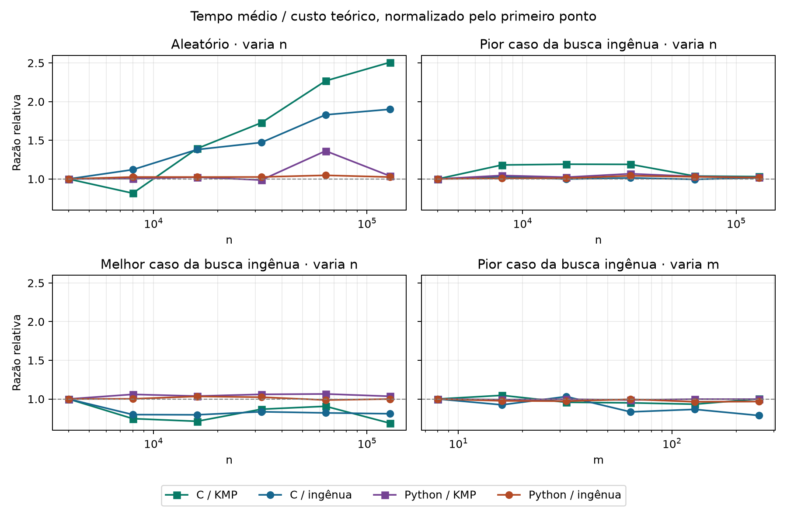

# Busca de padrões em strings

Comparação da busca ingênua e do algoritmo de Knuth–Morris–Pratt (KMP), ambos
implementados em C e Python. Cada implementação devolve a quantidade de
ocorrências, incluindo as sobrepostas, e o checksum das posições com índice
inicial 0 somadas módulo 2³².

## Reprodução dos experimentos

Use Python 3.10 ou mais recente, GCC e GNU Make. No Windows, use uma
distribuição com GCC, Make e utilitários de shell, como o w64devkit.
Com o Python no PATH, instale as dependências com
`python -m pip install -r requirements.txt` e execute `make all PYTHON=python`.

Em um shell Unix:

```bash
python3 -m venv .venv
source .venv/bin/activate
python3 -m pip install -r requirements.txt
make all
```

`make all` gera as entradas, compila o C, verifica a corretude, mede os tempos
e gera os gráficos. Para executar uma etapa, use `make data`, `make build`,
`make test`, `make bench` ou `make plots`.

Para consultar um caso isolado, execute `c/bin/cli <naive|kmp> T.txt P.txt`.
No Windows, o executável é `c/bin/cli.exe`. A saída é `count checksum`.

## Experimentos

- **Exp. 1** varia `n` de 4.000 a 128.000 (razão 2), com `m = 100`, nos casos aleatório, pior e melhor.
- **Exp. 2** varia `m` de 8 a 256 (razão 2), com `n = 128.000`, no pior caso da busca ingênua.
- **Testes** comparam as quatro implementações com `str.find` em 11 casos de
  borda, 30 casos aleatórios pequenos e o menor tamanho de cada um dos três
  grupos do Exp. 1.

No pior caso da busca ingênua, `T = a^n` e `P = a^(m-1)b`. No melhor,
`T = a^n` e `P = b^m`. O gerador usa semente 42 e grava em `data/cases.txt`
a lista de entradas compartilhada pelos dois benchmarks.

Cada implementação passa por três chamadas de aquecimento e 20 medições por
entrada. Os CSVs registram média (`time_s`), desvio-padrão amostral
(`stddev_s`) e número de repetições. A leitura de arquivos e a escrita dos
resultados ficam fora da região cronometrada. A medição do KMP inclui a
construção da tabela de prefixos em cada chamada.

## Resultados

[CSV do C](results/c.csv) · [CSV do Python](results/python.csv)






